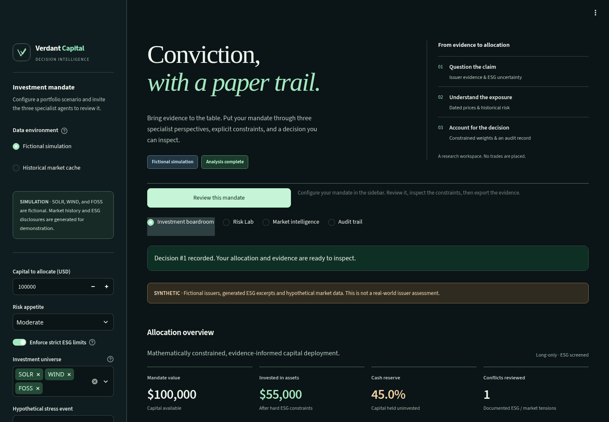
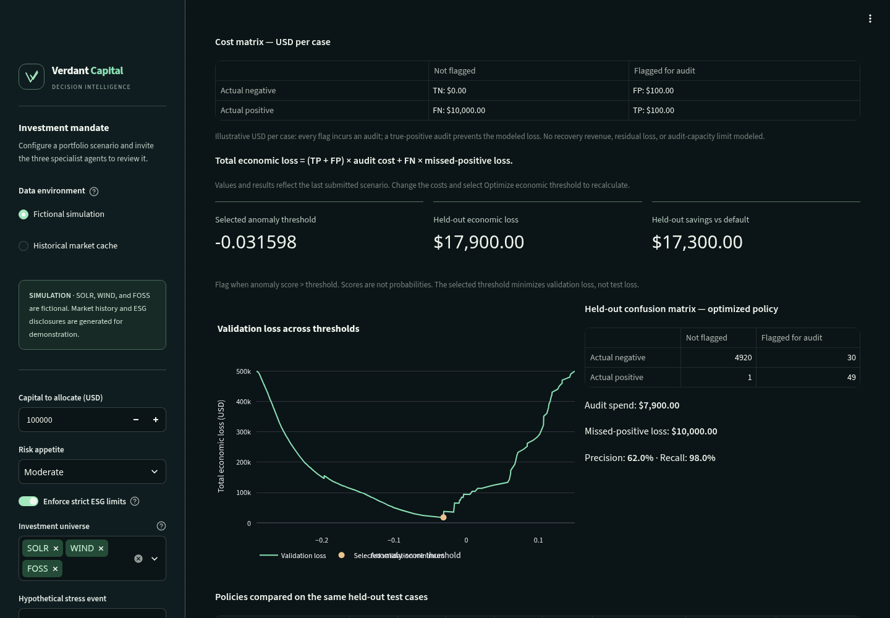
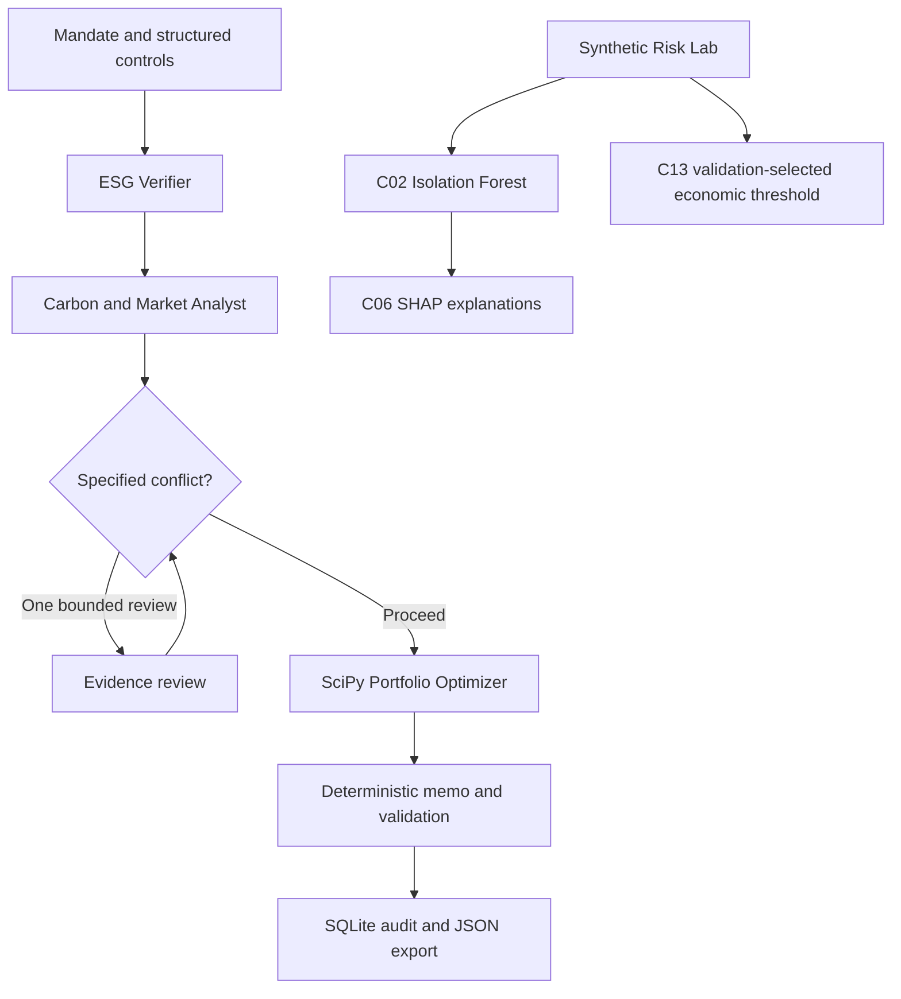

<div align="center">

# Verdant Capital

### Conviction, with a paper trail.

An investment research studio that makes evidence gaps, portfolio constraints, and the economics of a decision visible.

**Three specialist roles · Constrained allocation · Inspectable evidence**

**Repository maintainer:** [Fayaz Ali](https://github.com/Fayaz-Ali56)  
**Project credit:** Team Cypher — see [NOTICE.md](NOTICE.md) for attribution and rights information.

[Quick start](#quick-start) · [Judge walkthrough](#the-four-minute-walkthrough) · [Architecture](#architecture) · [QA report](QA_REPORT.md) · [Changes](CHANGELOG.md)

</div>



> Research prototype. No trades or credit decisions. Fictional examples and synthetic benchmarks are labeled. Historical price signals are estimates, not investment advice or demonstrated future returns.

## What it does

Verdant Capital is a research and decision-support prototype—not an automated trading
system, a source of personalized financial advice, or a guarantee of environmental
impact. It makes the assumptions behind a recommendation inspectable so that a
human reviewer can challenge the evidence and constraints before acting.


Verdant brings a mandate through three distinct responsibilities: examine ESG
source evidence, summarize dated market signals, and calculate an allocation
under explicit constraints. A bounded evidence review handles the implemented
high-ESG-risk / bullish-market conflict. A deterministic memo records the result.

- **Investment boardroom:** risk settings, exposure caps, cash fallback, specialist evidence, hypothetical demo stress events, and JSON export.
- **Risk Lab:** C02 rare-event detection, C06 feature attribution, C13 cost-sensitive threshold selection with a held-out economic audit, C04 out-of-bounds input guard, and C15 net financial gain in PKR.
- **Market intelligence:** cached adjusted prices, a KRBN carbon-related ETF projection, a bounded carbon-proxy scenario input when KRBN is explicitly selected, and a separately labeled feedback simulation.
- **Audit trail:** timestamped SQLite recommendations, policy reason codes, provenance and evidence citations.

The selected workspace alone renders. Opening the boardroom does not train C13
or load a large chart bundle. Native controls, visible keyboard focus, reduced
motion, responsive layout and explicit recovery states support the main flow.


## Assigned hackathon scope

This submission is aligned to **Battle of Intelligence — Mission/Pillar 2: Green
Capital Allocation & Portfolio Intelligence**. The three matching challenge
implementations in this repository are:

- **C02 — Severe Class Imbalance / Rare-Event Stress:** 99:1 synthetic evaluation
  with PR-AUC / Average Precision and a majority-class-collapse check.
- **C06 — Explainability & Feature Attribution:** three held-out edge-case SHAP
  explanations of the C02 anomaly score, with local additivity checks.
- **C13 — Cost-Sensitive Threshold Optimization:** a financial cost matrix,
  validation-only threshold selection and a separate held-out confusion matrix.

These are the **Battle of Intelligence** card definitions. The separately named
Battle of Byte cards C02 (concurrency), C06 (replay protection), and C13
(adversarial evasion) are different challenges and are not claimed as completed
by these C02/C06/C13 benchmark modules.

## Quick start

**Python 3.12** is the verified runtime. This is a Python application: there is no
Node application build or `node_modules` requirement. Run commands from the
repository root. A first dependency installation needs Internet access; the
fictional boardroom and synthetic evaluations subsequently need no API key.

### Windows PowerShell

```powershell
git pull origin main
py -3.12 -m venv .venv
.\.venv\Scripts\python.exe -m pip install --upgrade pip
.\.venv\Scripts\python.exe -m pip install -r requirements-dev.txt -c requirements-lock.txt
.\.venv\Scripts\python.exe scripts/check.py
.\.venv\Scripts\python.exe -m streamlit run app.py
```

### Linux / macOS shell

```bash
python3.12 -m venv .venv
.venv/bin/python -m pip install --upgrade pip
.venv/bin/python -m pip install -r requirements-dev.txt -c requirements-lock.txt
.venv/bin/python scripts/check.py
.venv/bin/python -m streamlit run app.py
```

Open `http://localhost:8501`. The initial fictional preview is not saved. Select
**Review this mandate** to run LangGraph and create a tracked recommendation.
Stop the server with Ctrl+C before restarting it after an update.

`requirements-lock.txt` contains the versions exercised on Linux/Python 3.12;
it is a constraints file, not a cross-platform artifact/hash guarantee. The CI
matrix declares Windows and Ubuntu checks. See QA_REPORT.md for which checks
were actually executed in this submission environment.

## The four-minute walkthrough

1. **The mandate.** Keep fictional mode, $100,000, moderate risk, strict ESG. Run the review. Show how allocation is accounted for, including cash.
2. **The evidence.** Open the specialist evidence and decision room. Fictional FOSS demonstrates how a positive market signal can conflict with ESG policy.
3. **The constraints.** Show excluded/restricted holdings, then select a hypothetical selloff and review again. Compare the actual calculated allocations. Export the complete audit.
4. **The model.** Navigate to Risk Lab → Detection & explanations. Explain the 99:1 accuracy trap and inspect a true positive, false positive and false negative.
5. **The economics.** Select Decision economics · C13. Explain the USD cost matrix, validation-loss minimum, frozen threshold, and held-out confusion matrix. Change missed-positive loss and rerun.

The bundled C02/C06 snapshot is a clearly labeled synthetic example. Generate
fresh reports to show results from your machine. C13 computes its own experiment
when selected; it is separate from both the portfolio and the bundled snapshot.

## Input guard and PKR impact: C04 / C15

Select **Input guard & PKR impact · C04 / C15** in the Risk Lab.

- **C04:** six injected edge cases (negative irradiance, 200% offset, latitude 95, NaN, non-binary flag, extreme outlier). Impossible values are rejected with a reason; possible-but-extreme values are flagged for human review. Run `python -m challenge.c04_guard`.
- **C15:** `Net Financial Gain = loss averted by true detections − cost of false alarms`, in PKR, from the C13 held-out confusion matrix, scaled to a portfolio size you choose. Costs and the USD/PKR rate (280) are **assumptions on synthetic cases**, not realized savings. Run `python -m challenge.c15_impact --portfolio-cases 1000000`.

See [the demo script](docs/DEMO_SCRIPT.md) for a rehearsed four-minute run.

## Decision economics: C13



The illustrative default scenario charges **$100 for every audit**, including
true positives, and **$10,000 for each missed positive**. A successful audit is
assumed to prevent the modeled loss fully.

| Actual outcome | No audit | Audit |
|---|---:|---:|
| Negative | TN: $0 | FP: $100 |
| Positive | FN: $10,000 | TP: $100 |

`Total loss = (TP + FP) × audit cost + FN × missed-positive loss`

An exact search over distinct **validation** score boundaries selects the lowest
loss; equal scores stay together, and ties prefer fewer audits. The threshold is
then frozen and evaluated on a separate test set. Audit-all, audit-none and the
default zero threshold are compared on identical test cases. Negative held-out
savings remain visible. Scores are anomaly scores, not probabilities.

[Full C13 methodology and limitations](docs/C13_DECISION_ECONOMICS.md).

## Historical prices and optional providers

Download dated market data before selecting Historical market cache:

```powershell
.\.venv\Scripts\python.exe -m data.fetch_market
.\.venv\Scripts\python.exe -m data.carbon_forecast
```

Return to the boardroom and run the review again. These commands use Yahoo
Finance through yfinance. Clicking review reads the local cache; it does not
refresh prices automatically. Missing/invalid prices receive zero exposure.
KRBN is an ETF proxy, not a spot carbon-credit quote. When KRBN is explicitly
in the selected portfolio universe, its 30-session proxy change is shrunk to 25%
and capped at +/-5 annualized percentage points as a transparent scenario input
to that KRBN position only. It does not alter other issuers, and it is not a
calibrated prediction or a direct carbon-credit spot-price forecast. The memo
records the scenario adjustment and per-asset allocation explanations.

Optional issuer-report analysis:

```powershell
.\.venv\Scripts\python.exe -m pip install -r requirements-rag.txt -r requirements-llm.txt
Copy-Item .env.example .env
# Enter optional credentials in .env locally, never in Git.
# Place permitted PDFs in data_cache/pdfs/, e.g. NEE__2025_report.pdf.
.\.venv\Scripts\python.exe -m data.build_rag
```

Indexing requires optional model downloads. Retrieval filters by issuer and
preserves filename/page citations. Uploaded reports are **not independently
authenticated**. An available document is not proof of its claims. Without
usable evidence and a valid provider response, ESG remains unverified.
Provider-backed RAG is not part of the verified offline demonstration.

### Environment variables

No `.env` file is required for the offline workflow. Process variables override
`.env`; copy the complete [.env.example](.env.example) only when needed.

| Variable | Default / purpose |
|---|---|
| `LLM_PROVIDER` | `auto`; optional `gemini` or `openrouter` |
| `GEMINI_API_KEY` | Empty; optional credential |
| `GEMINI_MODEL` | `gemini-2.5-flash` |
| `OPENROUTER_API_KEY` | Empty; optional credential |
| `OPENROUTER_MODEL` | `openrouter/free` |
| `VERDANT_DATA_DIR` | `./data_cache`; generated caches and reports |
| `VERDANT_RAG_DIR` | `./rag_db`; optional vector index |
| `VERDANT_FEEDBACK_DB` | `<data directory>/feedback.db` |

Relative data/index paths resolve from the project root. Documents, caches,
provider responses, credentials and outcome databases stay out of source ZIPs.

## Architecture



LangGraph runs the specialists sequentially with conditional routing. These are
three responsibilities, not three independently trained LLMs. Review, synthesis
and persistence are deterministic steps, not additional investment agents.

The optimizer uses clipped annual historical means, regularized covariance,
a risk penalty, ESG soft penalties, and hard position bounds. SLSQP calculates
long-only weights summing to 100%. An LLM does not set the numerical allocation.
The UI's historical return estimate is distinct from the ESG-adjusted objective.
Cash defaults to zero modeled return and covariance; inflation and execution
costs are not represented.

### Important interpretation rules

- Missing ESG evidence means **unverified**, not fraud or zero sustainability.
- Strict mode caps unverified holdings at 10%; it does not require investing 10%.
- XOM is not automatically excluded by sector. There is no blanket fossil-fuel policy.
- Free-text principles are recorded; structured controls enforce policy. Arbitrary prose does not become an optimizer constraint.
- Market confidence is a history-length heuristic, not a calibrated probability.
- C02/C06/C13 features and outcomes are synthetic; they do not validate detection on real issuers.
- SHAP explains the separate anomaly score, not allocation weights or causality.
- Feedback weights use smoothed outcome records; synthetic history cannot influence market-mode weights. Automatic future-return matching is not implemented.

## Commands and project map

Use `.venv/bin/python` on Linux or `.\.venv\Scripts\python.exe` on Windows:

| Command suffix | Purpose |
|---|---|
| `scripts/check.py` | Dependency check, lint, format check, full tests, real UI smoke, compilation |
| `-m challenge.c02_rare_event` | Five-seed rare-event evaluation |
| `-m challenge.c06_explainability` | Three held-out SHAP explanations and PNGs |
| `-m challenge.c13_cost_sensitive --audit-cost 100 --missed-loss 10000` | Financial matrix, threshold selection and held-out audit |
| `-m data.feedback_backtest` | Separate, explicitly simulated influence timeline |
| `-m orchestrator.graph` | Persist a fictional boardroom review |
| `-m streamlit run app.py` | Start the local studio |
| `tools/package_release.py` | ZIP of tracked source only |

`scripts/prepare_demo.ps1` installs the constrained development dependencies,
checks the project, generates all evidence, and starts the app. It stops on a
failed native command.

| Directory | Responsibility |
|---|---|
| `app.py`, `ui/` | Workspace routing, presentation, chart grammar and design tokens |
| `orchestrator/` | State, bounded review, deterministic memo |
| `agents/` | Optional provider calls and source-aware ESG prompt |
| `data/` | Price ingestion, allocation, reports, persistence, optional RAG |
| `challenge/` | C02/C06/C13 evaluation and UI |
| `tests/` | Behavioral, adversarial, economic and UI regressions |
| `assets/benchmark_snapshot/` | Labeled reproducible C02/C06 sample evidence |
| `docs/` | Actual screenshots, architecture, evidence contracts and limits |

## Testing, accessibility and performance

[QA_REPORT.md](QA_REPORT.md) records actual passes, failure injection, concurrency,
browser coverage, automated accessibility and Lighthouse results, and remaining
triage. [CHANGELOG.md](CHANGELOG.md) describes the final changes.

The interface provides a dark theme, a skip link, named native controls, visible
focus, text equivalents for allocation graphics, a real-work loading skeleton,
and a reduced-motion override. Automated accessibility checks do not substitute
for a complete manual WCAG AA certification.

Optional browser tooling is separate from the Python app:

```bash
npm install --prefix .qa-tools playwright @axe-core/playwright lighthouse
node tools/browser_qa.cjs
```

Install Playwright browsers separately or set `CHROME_PATH` to an available
Chromium executable. `VERDANT_QA_URL` selects the running local server. Browser
reports go to ignored `dist/browser-qa/`. Lighthouse needs a running server and
an available Chrome executable. The QA report distinguishes framework limits
from changes under this repository's control.

## Deployment boundary

The default server binds to **127.0.0.1** with XSRF/CORS protection enabled and
telemetry disabled. This is a **single trusted operator workspace** with a shared
local audit database, not a multi-tenant SaaS service. It has no account system,
authorization layer or tenant isolation. Do not publish it directly to the
Internet; use an authenticated reverse proxy and isolated storage for deployment.
Never disable TLS verification to make an optional provider work.

A Dockerfile and loopback-bound Compose example are included. On Linux, writable
bind-mounted data/index directories must permit the container's UID 1000.
The Docker image build and local browser review were verified here. Windows
execution, real provider calls and non-Chromium browsers remain unverified where
QA_REPORT.md marks them unrun.

## Roadmap

- Independently labeled issuer evidence and tested document-feature extraction.
- Issuer/time-separated evaluation, calibrated uncertainty and cost sensitivity.
- Transaction costs, liquidity, turnover and realistic portfolio backtesting.
- Authenticated multi-user operation, tenant-scoped storage and retention policy.
- Verified future outcomes before automated feedback adaptation.
- Frontend delivery improvements beyond the current Streamlit framework limits.

## Ownership, licensing and attribution

Verdant Capital was developed as a hackathon project by **Team Cypher**. The
repository is maintained by [Fayaz Ali](https://github.com/Fayaz-Ali56). The
project uses a **Proprietary — All Rights Reserved** notice: public visibility
does not grant permission to copy, modify, redistribute, sublicense, or
commercially use the original project materials. Individual contributors retain
whatever rights they hold in their contributions unless a separate written
agreement provides otherwise. Third-party components remain under their own
licenses. Read [LICENSE](LICENSE) and [NOTICE.md](NOTICE.md) before reuse.
